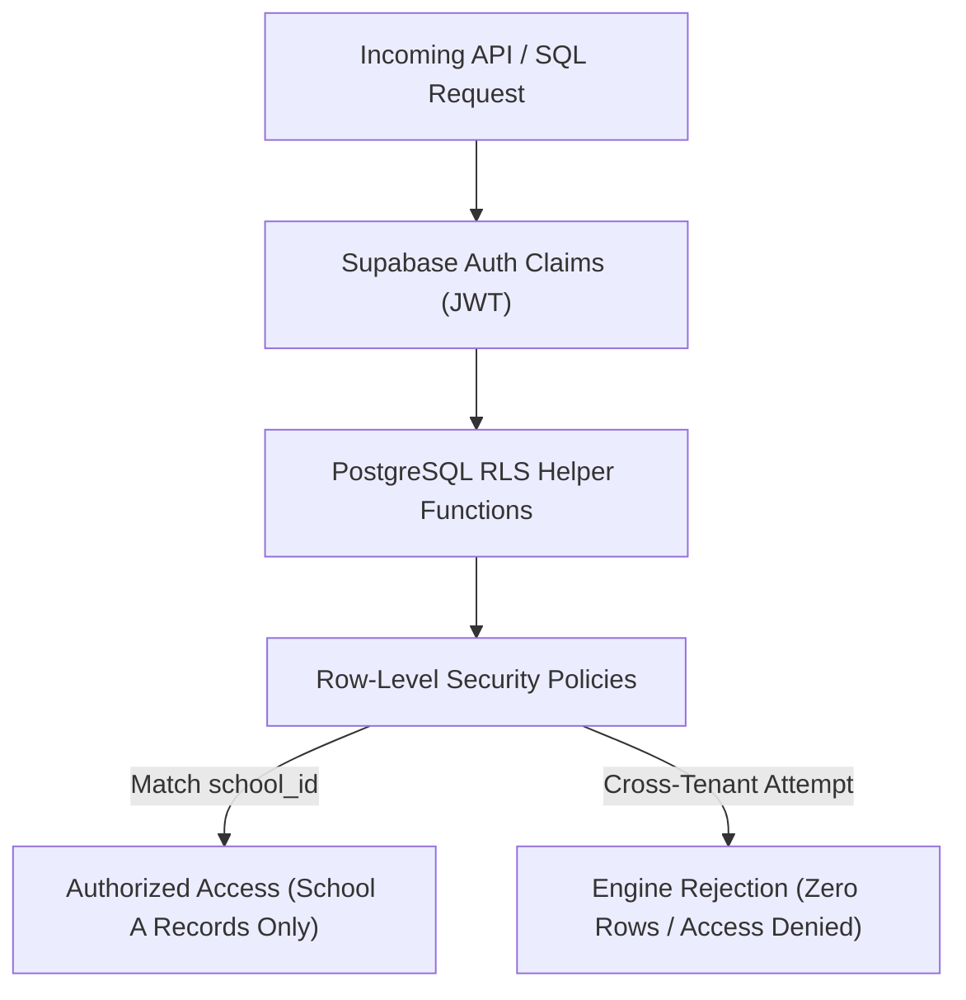

# Multi-Tenant Isolation & Security Model

## 1. Architectural Tenant Isolation

SIS Smart School implements hard tenant isolation at the PostgreSQL database engine level using Row-Level Security (RLS). Under no circumstances is tenant filtering delegated solely to client-side code or frontend WHERE clauses.



---

## 2. PostgreSQL RLS Implementation

Every tenant-owned table features:
1. `school_id UUID NOT NULL REFERENCES schools(id) ON DELETE CASCADE`
2. An index on `(school_id)`
3. Mandatory `ALTER TABLE <table_name> ENABLE ROW LEVEL SECURITY;`

### Security Functions
```sql
-- Resolves the active tenant ID of the authenticated user
CREATE OR REPLACE FUNCTION auth.current_user_school_id()
RETURNS UUID AS $$
    SELECT school_id 
    FROM user_school_memberships 
    WHERE user_id = auth.current_user_id() 
      AND is_active = true 
    ORDER BY is_primary DESC, created_at ASC 
    LIMIT 1;
$$ LANGUAGE sql STABLE SECURITY DEFINER;

-- Verifies Platform Super Admin privileges
CREATE OR REPLACE FUNCTION auth.is_super_admin()
RETURNS BOOLEAN AS $$
    SELECT EXISTS (
        SELECT 1 
        FROM platform_admins 
        WHERE user_id = auth.current_user_id() 
          AND is_active = true
    );
$$ LANGUAGE sql STABLE SECURITY DEFINER;
```

---

## 3. Threat Mitigation Matrix

| Threat Category | Potential Attack Vector | Platform Countermeasure |
|---|---|---|
| **IDOR (Insecure Direct Object Reference)** | Client tampers with student/invoice ID from another school | PostgreSQL RLS automatically enforces `school_id = auth.current_user_school_id()`, returning 0 rows. |
| **Privilege Escalation** | School Admin sends manipulated role metadata | Authorization checks verify database `user_school_memberships` table, never trusting user-editable client claims. |
| **Cross-Tenant Data Leakage** | Shared cache or un-partitioned search | All DB queries, realtime subscriptions, and storage buckets are scoped by `school_id`. |
| **Code Injection via SDUI** | Malicious script payload injected in remote configuration | SDUI engine renders only verified, pre-compiled component types. Arbitrary scripts are strictly rejected by Zod validation. |
